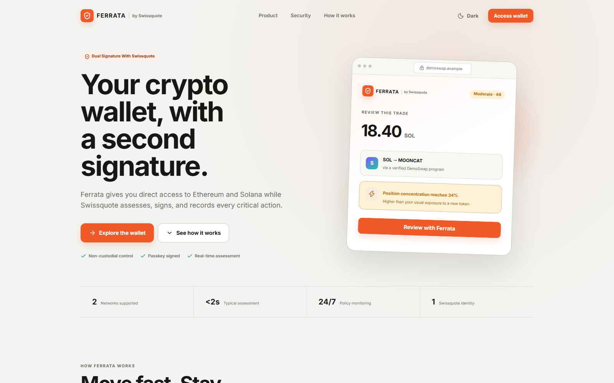
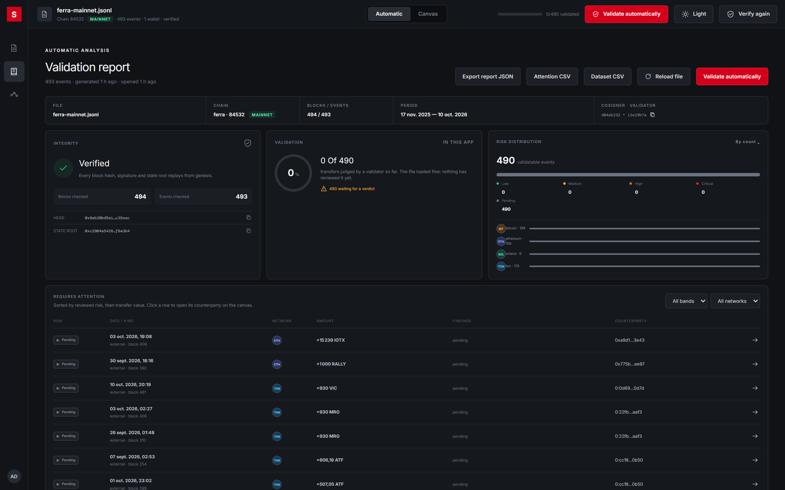

<!-- _paginate: false -->

## Swissquote Wallet track · Ferrata

Clients who want their own keys leave the bank.

Today they withdraw to an external wallet and leave the ecosystem. Ferrata gives them their keys, one step from their account.

  Passkey, no seed phrase
  Bank-grade risk analysis
  Recovery without the bank alone

  

---

## Custody model · creation · authentication

# 2-of-2 where only you can spend

  

<svg viewBox="0 0 24 24" fill="none" stroke="#3fd69b" stroke-width="2"><circle cx="8" cy="15" r="4"/><path d="M11 12l9-9M17 6l3 3M15 8l2 2"/></svg>

<b>Your passkey</b>Created on your device, Face ID / fingerprint. Signs every payment. real

  

<svg viewBox="0 0 24 24" fill="none" stroke="#b3a6ff" stroke-width="2"><rect x="6" y="2" width="12" height="20" rx="3"/><path d="M11 18h2"/></svg>

<b>Your recovery phone</b>Paired by QR, its key registered on the account. real

  

<svg viewBox="0 0 24 24" fill="none" stroke="#ff5a2a" stroke-width="2"><path d="M3 10l9-6 9 6M5 10v9M19 10v9M9 10v9M15 10v9M3 21h18"/></svg>

<b>The bank</b>Analyses risk, signs a receipt, attests KYC. Holds no key to your funds.

  
<b>Create</b>Log in to the bank account → passkey on the device → it signs a bank challenge → wallet bound to the client ID

  

    
Who, alone…

Send

Block

Change key

    
Your passkey

✓

✕

✕

    
Recovery phone

✕

✕

✕

    
The bank

✕

✕

✕

    
Phone + bank KYC + delay

✕

✕

✓you can cancel

  

  

    
<b>Low</b>one touch

    
<b>Medium</b>2nd confirmation

    
<b>High</b>explained score + "I understand"

    
<b>Sanctions</b>strongest warning, decision recorded

  

  

    
<b>Pros</b>No seed phrase · the bank can neither move nor freeze funds · works if the bank is down

    
<b>Cons</b>Lost passkey + phone → needs the bank's KYC · risk checks are advice, not a lock

  

---

## Threat model · recovery

# Lost passkey? Phone + identity + time.

  
<b>Pair a phone</b>QR + fingerprints checked on both screens real

  
<b>"I lost my passkey"</b>new passkey on the new device, QR to the phone real

  
<b>Phone signs + KYC</b>ID document MRZ, age, expiry real · video, face, NFC simulated

  
<b>Smart delay</b>base ×1 to ×14 from account history, reasons on both devices real

  
<b>Rotation</b>needs phone signature <em>and</em> bank attestation, on chain real

  
<b>Phishing site</b>Explained risk score and warning before signing

  
<b>Stolen phone + email</b>Phone alone can't send. Recovery still needs KYC; the old passkey gets an alert and cancels

  
<b>The bank, alone or with a partner</b>Cannot move, freeze or rotate: the phone's signature is required on chain

  
<b>Bank gone for good</b>The passkey alone keeps moving funds. No bank signature needed

Known limit: if the attacker retries after a cancel ("contested"), the delay grows but the old passkey can no longer cancel; KYC is then the last barrier, and it is simulated today.

---

## Architecture · real vs mocked

# Real chains, every transfer traceable

  
Client

  

<b>Chrome extension</b>passkey, sends, dApp provider

<b>Phone app</b>recovery key, KYC

  
Testnets · signed and broadcast

  

<b>Base Sepolia · gasless USDC</b>ERC-4337 smart account, Pimlico paymaster pays the gas

<b>Solana devnet</b>Ed25519

  
Bank services · Rust

  
<b>Risk engine · receipts · audit log · recovery attestation</b>connectors read Bitcoin, Ethereum, Solana, TON

  
<b>Compliance provider</b>KYC, sanctions list, exposure graph mocked

  
<b>"Ferra" ledger</b>account rules, signed blocks, replay-verified; mirrors every network's activity own chain

  
Compliance desk · Ferra Visualizer

  

  

    Replays every blockScores each transferRisk by networkSanctioned &amp; reported addressesFollows the moneyExports for auditors
  

---

## Legal · business

# Software, not custody: the bank can never act alone

  
<b>Custody · Art. 242a DEBA</b>Only the client's passkey can spend; the bank cannot move, freeze or rotate the funds alone, nor with a partner. No power of disposal, so not custody. To be validated with compliance.

  
<b>Travel Rule · FINMA 02/2019</b>Ownership proved by construction: the passkey signs a bank challenge at creation, bound to the identified client. Every transfer is recorded with sender, recipient, asset and amount. Sending institution for third-party payments? To be validated.

  
<b>Sanctions</b>The bank warns and records the decision, but does not refuse, because it does not hold the key. Whether that is enough under Swiss sanctions law: to be validated with compliance.

  
<b>What the bank gains</b>Keeps the crypto client and the flow back to the account · paid analysis tier · gasless transfers billed in CHF · fees on compliant DeFi · KYC recovery nobody else offers · no client keys to insure

  

    

723 M
CHF revenue 2025

    

85.7 M
CHF from crypto (≈12 %)

    

−12.1 %
crypto volume 2025

  

Reported FY2025 figures (press coverage of Swissquote results). What share of crypto clients would self-custody is an assumption to validate.

---

<!-- _paginate: false -->

## Bonus · limits · conclusion

  
<b>Gasless · done</b>USDC on Base Sepolia through an ERC-4337 account; Pimlico's paymaster pays the gas under a sponsorship policy. The client never holds ETH.

  
<b>dApps · partial</b>EIP-1193 / 6963 provider, origin from the browser; the bank's site reads the wallet and sends through the Ferrata window. Third-party dApp signing waits for the approval window.

  
<b>Simulated</b>Video KYC, face match, NFC chip. The "Ferra" ledger enforces the account rules; the testnets carry real transfers.

Your key. Your money. A bank that has your back, not your keys.

